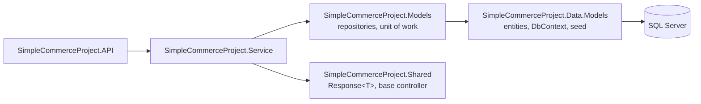

# SimpleCommerceProject

An ASP.NET Core 5 Web API for a small product catalogue with categories and attribute-based filtering, built on EF Core, SQL Server and a layered architecture.

> **📦 Archived** — this is an early learning project (2021), kept for reference only. It targets an end-of-life framework and is not maintained.


## Overview

Products belong to a category; each category defines attributes (e.g. *Size*, *Color*, *OS*) with values, and products are linked to attribute values. On startup the API creates the database and seeds two categories, two products and their attributes (with Polly retries while SQL Server starts).

| Endpoint | Description |
|---|---|
| `POST /api/Category` · `PUT/DELETE /api/Category/{id}` | Create, update, delete (delete cascades to attributes, values and products) |
| `GET /api/Category/GetByCategoryName/{name}` | Find a category by name |
| `POST /api/Category/GetByCategoryAttributes` | Categories that own the given attributes |
| `POST /api/Product/Create` · `PUT /api/Product/Update/{id}` · `DELETE /api/Product/Delete/{id}` | Product CRUD |
| `GET /api/Product/GetByName/{name}` | Find a product by name |
| `GET /api/Product/GetListByCategoryName/{name}` | Products in a category (response-cached for 10 s) |
| `POST /api/Product/GetListByPriceRange` | Products within `minPrice`–`maxPrice` |
| `POST /api/Product/GetListByProductAttributes` | Products matching attribute/value pairs |
| `DELETE /api/Product/DeleteWithMediatR/{id}` | Same delete, dispatched through a MediatR command |

Responses are wrapped in a common `Response<T>` (`data`, `errors`) and the HTTP status code comes from the service layer.

## Architecture



## Tech stack

- ASP.NET Core 5.0 Web API, Swagger (Swashbuckle)
- Entity Framework Core 5 with SQL Server (HiLo key generation, `IEntityTypeConfiguration` mappings)
- AutoMapper, MediatR, Polly
- Docker / Docker Compose (Visual Studio container tooling)

## Project structure

```
SimpleCommerceProject.API/          Controllers, Startup, Dockerfile
SimpleCommerceProject.Service/      Services, resources (DTOs), mapping, MediatR command
SimpleCommerceProject.Models/       Repositories and unit of work
SimpleCommerceProject.Data.Models/  Entities, CommerceContext, entity configurations, seeding
SimpleCommerceProject.Shared/       Response wrapper and CustomBaseController
docker-compose*.yml                 API + SQL Server
```

## Getting started

Prerequisites: [.NET 5 SDK/runtime](https://dotnet.microsoft.com/download/dotnet/5.0) and SQL Server (LocalDB by default), or Docker.

```bash
# Local: uses (localdb)\MSSQLLocalDB from appsettings.json
dotnet run --project SimpleCommerceProject.API      # Swagger: http://localhost:5000/swagger

# Docker: API on http://localhost:8001, SQL Server on 1433
docker compose up --build
```

## Notes and limitations

- The database is created with `EnsureCreated()`; there are no EF migrations.
- The SQL Server password in `docker-compose.override.yml` is a local development value — change it before any shared use.
- The `mssql/server:2017` image is amd64-only; on Apple Silicon use a different SQL Server image (e.g. Azure SQL Edge).
- `SimpleCommerceProject.Data.Service` is an empty project and is not part of the solution.
- No authentication or tests.
